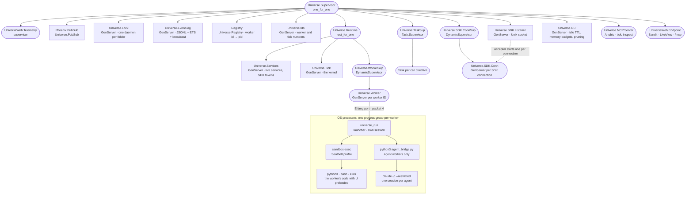
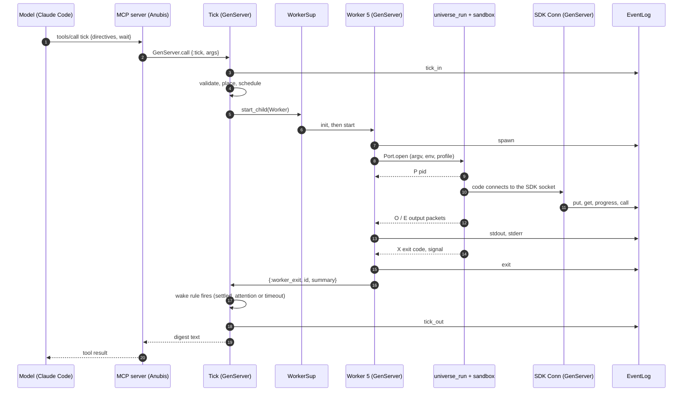
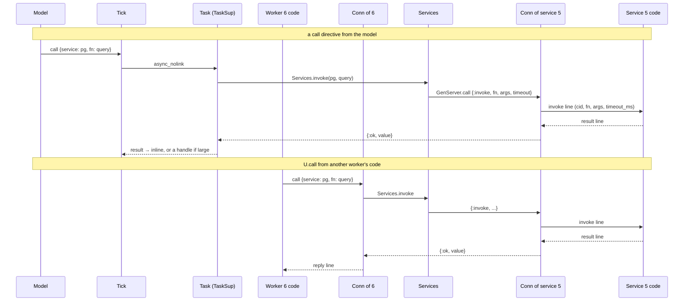
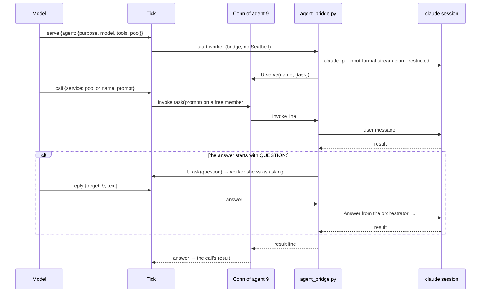
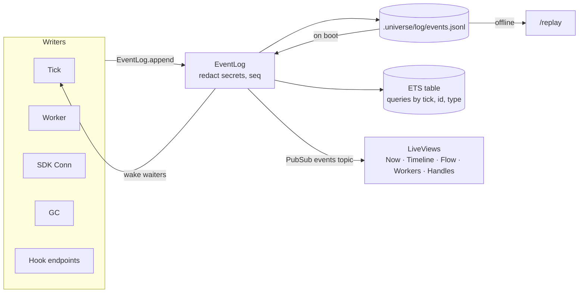

# Universe architecture

Universe is one OTP application per project folder. A coding-agent CLI (the
"model", for example Claude Code) talks to it over MCP with two tools, `tick`
and `inspect`. Everything the model asks for runs as a **worker**: a
GenServer in the daemon that owns one sandboxed OS process tree. Every step
is appended to an **event log**, which also feeds the web observer.

The diagrams below render on GitHub. Live versions of the same pictures are
in the observer:

- `/system`: this supervision tree, live, with each process's role, queue,
  memory and activity, and every worker's OS processes
- `/flow`: who talks to whom as a graph; edges animate as messages cross
- `/timeline/:tick`: one tick's flow as a sequence diagram
- `/` (Now): agents, services, running work and every event as it happens
- `/dashboard`: Phoenix LiveDashboard (generic processes, ports, ETS)

## 1. Supervision tree

Rounded boxes are supervisors (with their strategy), plain boxes are
GenServers, stadiums are processes started on demand, and the dotted part
is outside the BEAM (OS processes).



Why the shape:

- **`Runtime` is `rest_for_one`.** If `Tick` crashes, `WorkerSup` restarts
  too, so no worker outlives the state that tracks it. The new `Tick`
  rebuilds its worker table from the event log; workers that were running
  are recorded as `killed · lost: Universe restarted`.
- **One GenServer per worker, one OS process group per GenServer.** The
  launcher puts the code in its own session and kills the whole group when
  the code exits, when told to (`K`), or when the port closes because the
  GenServer died. Workers are `:temporary`: `Tick` decides about restarts
  (services: at most 3 in 60 s), not the supervisor.
- **SDK connections are separate GenServers** under `ConnSup`, so a hung or
  chatty worker can't block `Tick`. A connection proves which worker it is
  with the token it was given in `UNIVERSE_TOKEN`.
- **Agent workers** run the bridge instead of the Seatbelt sandbox, because
  `claude` needs your login and the Claude API. The bridge runs
  `claude --restricted`: no code-running tools, file tools confined to the
  project, writes only to leased paths, `.universe/` denied.

## 2. A tick, end to end



The model never waits longer than its `wait.timeout_s` (90 s at most).
Workers keep running after the digest; their later events are reported by
the next tick.

## 3. Calling a service

A service is a worker whose code called `U.serve(name, fns)`. There are two
ways to call it, and both end up as an `invoke` line on the service's own
SDK connection, handed over one at a time.



Events: a call directive logs `call` with `via: tick` and its result in the
call ID's `exit`; a `U.call` logs `call` with `via: sdk` and `call_done` on
the caller's ID.

## 4. Agent workers



The session ID is saved in `.universe/agents/<name>.json`, so serving the
same agent again (after a kill, a crash or a daemon restart) resumes its
conversation. A task past its call's deadline is interrupted with a
stream-json `interrupt` control request.

## 5. Events and the observer



## 6. Who talks to whom

| From | To | How | What |
|---|---|---|---|
| Model | MCP server | HTTP, bearer token | `tick`, `inspect` |
| MCP server | `Tick` | `GenServer.call` via `Universe.API` | directives and wait; `inspect` reads the event log, handles and `Tick.snapshot` |
| `Tick` | `WorkerSup` | `DynamicSupervisor.start_child` | new workers |
| `Tick` | `TaskSup` | `Task.Supervisor.async_nolink` | call directives |
| `Worker` | launcher | Erlang port, `{packet, 4}` | start, `K` kill; back: `P` pid, `O`/`E` output, `X` exit |
| `Worker` | `Tick` | message `{:worker_exit, ...}` | summary when the process ends |
| worker code | `Listener` → `Conn` | Unix socket, JSON lines | `put`, `get`, `progress`, `ask`, `call`, `serve` |
| `Conn` | `Tick` | `GenServer.call` | `ask` (blocks for the model's reply), `service_ready` |
| `Conn`, call `Task` | `Services` → service `Conn` | `GenServer.call {:invoke, ...}` | a service function call |
| `GC` | `Tick`, `Worker` | casts | stop idle services, kill over-budget groups |
| everyone | `EventLog` | `append` | one event per step |
| `EventLog` | LiveViews, `Tick` | PubSub | live pages; tick wake-ups |

## 7. Files

```
.universe/
  port, token            how the CLI reaches this daemon (token mode 0600)
  log/events.jsonl       every event, append-only (redacted)
  runs/<id>/             a worker's code, stdout, stderr, sandbox.sb, token
  handles/<id>/          stored values: <name>.json + <name>.meta.json
  agents/<name>.json     an agent's saved session ID (+ .usage.jsonl)
  secrets/<service>.env  per-service secrets, never readable by workers
  sdk.sock               the SDK socket (or $TMPDIR/universe-<hash>.sock)
```
